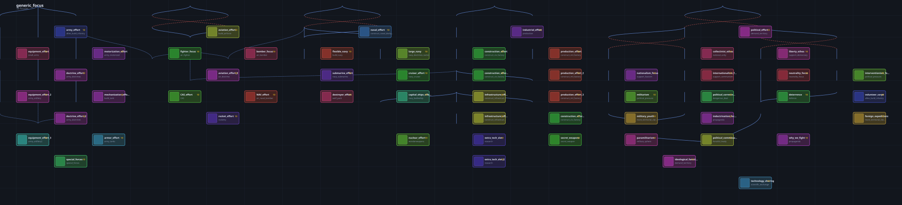

# 国策树查看器 · HOI4 Focus Viewer

拖入 mod 文件夹，直接看《钢铁雄心 4》国策树结构图。

不装东西、不注册、不上传——双击 `index.html` 就能用，只在本机读 `common/national_focus/*.txt`。



---

## 为什么做这个

这个需求九年前就被验证过：[FocusTreeAndEventManager](https://github.com/Minivera/FocusTreeAndEventManager)
（38 star / 32 fork）能管理和可视化国策树。但它是个 Windows 桌面 C# 程序，
**2018 年归档**，面对的是七八年前的游戏版本。

后来这个位置被网页端的 [钢之工坊](https://scharnhorst.hagane.works/) 接住了，
它做得很好，但形态是**托管服务**：要注册、项目存服务器、导出是 ZIP。

中间缺一档：

> **现代的、开源的、跑在你自己仓库里的查看器。**

这个项目就填这一档。它是只读的，不做编辑，不和谁抢位置。

## 用法

1. 下载这个仓库（`git clone` 或右上角 Download ZIP）
2. 双击 `index.html`
3. 把 mod 文件夹（或整个游戏目录）拖进页面

浏览器只在本地读文件，没有任何网络请求。

| 操作 | 效果 |
|---|---|
| 滚轮 | 缩放 |
| 拖动空白处 | 平移 |
| 单击节点 | 右侧展开详情，同时高亮整条前置/后继链 |
| 详情里的标签 | 点前置或互斥项，直接跳过去并居中 |
| 搜索框 | 按 id 过滤 |
| 搜索后按回车 | 跳到第一个命中项并居中 |
| `Esc` | 取消选中、关掉详情 |
| 导出 SVG | 存成图片 |

## 它做的事

- **解析 Clausewitz 脚本**：注释、引号字符串、嵌套块、BOM、裸露的列表值
- **换算坐标**：带 `relative_position_id` 的国策，把相对偏移解成绝对坐标
- **按 x / y 直接画**：HOI4 的坐标本来就是作者手写的，换算一下就是最终位置
- **区分边**：实线 = 前置，虚线 = 多组前置（满足其一），红色虚线 = 互斥
- **详情面板**：成本、坐标、前置分组、互斥项，以及 `available` / `completion_reward` / `bypass` 的原始脚本
- **优先读 `national_focus`**：拖整个游戏目录进来时，先把几千个无关 `.txt` 挡掉

## 坐标系怎么处理

渲染时有两套坐标，混用会让连线和节点整体错位：

| 变量 | 含义 | 用途 |
|---|---|---|
| `_px` / `_py` | 网格坐标，可能是负数 | 只用来算包围盒 |
| `_sx` / `_sy` | 加上画布偏移后的最终坐标 | 所有绘制统一用它 |

测试里有一条专门的回归用例，逐个检查连线起点是否落在节点的边框上。

## 为什么不做自动布局

大多数图形工具会用力导向之类的算法自动排版。这里故意不做，原因有两个：

1. 游戏里的布局就是 `x` / `y` 写的，照着画才和游戏里一致
2. 自动布局在几百个节点的树上既慢又难看

所以从脚本到图的映射是**确定的**：同一个文件，永远画出同一张图。

## 测试

```bash
node test/clausewitz.test.js

# 顺带用真实游戏文件跑一遍（81 个文件、1 万多个国策）
HOI4_PATH="C:/Program Files (x86)/Steam/steamapps/common/Hearts of Iron IV" \
  node test/clausewitz.test.js
```

没有依赖，不需要 `npm install`。

## 导出图片

```bash
node tools/export-svg.js <文件或目录> --list          # 看看有哪些树
node tools/export-svg.js <文件> --tree <树 id> --out out.svg
```

`docs/preview.svg` 就是这么生成的：`generic.txt` 里的 `generic_focus`，56 个国策。

## 已知限制

- **图标是占位色块**。游戏用 `.dds`，浏览器读不了。想显示真图标，得先转成 PNG
- **大树非常宽**。`belgium_focus` 画出来有 20000px 宽——这是游戏原始布局的宽度，不是 bug
- **只读**。不能编辑、不能保存
- **共享国策只能静态还原一部分**。`shared_focus = X` 的导入已经支持，但原版还有 6 处前置指向了没被显式共享进该树的国策（`belgium_focus` 4 处、`congo_focus` 2 处）——这些是游戏用 `dynamic = yes` 在运行时按国家解析的，静态分析看不出结果

## 路线图

- [ ] 读 `.gfx` 拿到图标清单，把色块换成真图标
- [ ] 读 `localisation/*.yml`，把 id 换成游戏里的中文名
- [x] 树与树之间的 `shared_focus` 关联
- [ ] 生成 PNG / 缩略图，方便贴进 PR
- [ ] 做成 VS Code 扩展，在编辑器里直接看

## 相关项目

| 项目 | 关系 |
|---|---|
| [CWTools](https://github.com/cwtools/cwtools-vscode) | 语言服务器，做校验。本项目不重复它的工作 |
| [clausewitz-mcp](https://github.com/jacklenzotti/clausewitz-mcp) | 面向 AI 的符号索引和 mod 校验 |
| [FocusTreeAndEventManager](https://github.com/Minivera/FocusTreeAndEventManager) | 2018 年的桌面版，已归档 |
| [钢之工坊](https://scharnhorst.hagane.works/) | 托管的可视化编辑器，功能最全 |

## 许可证

MIT
